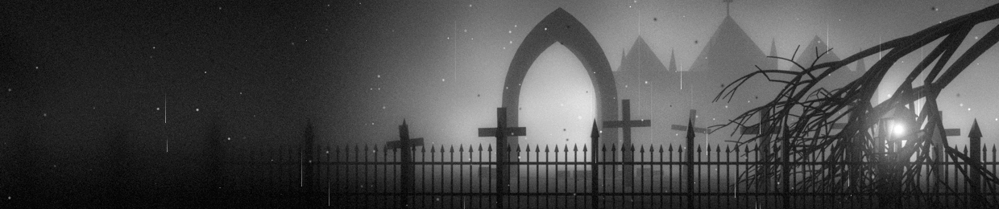

```
 ┌─ vicente guerra ─────────────────────────────┐
 │  audio tools · web · music as NEMURA         │
 │  IT engineering @ UCN, chile                 │
 └──────────────────────────────────────────────┘
```

I build audio tools (DSP, plugins, metering) and web projects.
I also make music as **NEMURA**.

**Selected work**

- [nemura-stereometer](https://github.com/nemura0/nemura-stereometer): stereo goniometer and vectorscope for Apple Silicon, as a floating app and CLAP/VST3/AU plugin
- [pdf2md](https://github.com/nemura0/pdf2md): offline PDF to Markdown from a Finder Quick Action (Swift, PDFKit, Vision)
- [ecowaste](https://ecowaste-seven.vercel.app): map of e-waste drop-off points in Coquimbo, built for a UCN course (Astro, in Spanish)
- [MusicBot-InventarIA](https://github.com/nemura0/MusicBot-InventarIA): Discord music bot in TypeScript

**Now:** learning DSP and audio plugin development in C++.

[vicguerra.dev](https://vicguerra.dev) · [x](https://x.com/nemura0) · [mail](mailto:vicentegve@gmail.com)
